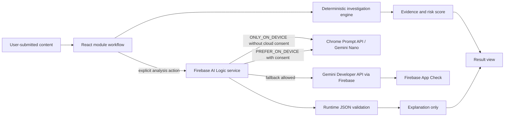

# TrustLens Architecture

Updated: 2026-11-23

## Runtime shape

## Frontend

- `src/App.tsx` provides the overview, five module forms, session-only recent checks, privacy settings, and result presentation.
- `src/security/investigate.ts` performs local URL and text checks. It does not fetch URLs or consult reputation services.
- `src/security/types.ts` defines the common module, evidence, risk, and result contracts.
- `src/ai/analyze-with-ai.ts` builds an untrusted-content prompt, requests a structured explanation, validates it, and requires Firebase's inference-source metadata.
- `src/ai/routing.ts` selects local-only or local-preferred mode from the user's per-check cloud consent.
- `src/firebase/firebase.ts` lazily initializes Firebase App Check and Firebase AI Logic when an analysis is requested. It has no React rendering responsibility.

## Trust boundaries and data flow

1. The browser receives user text or an address. Content is never fetched by TrustLens.
2. Deterministic checks run in the browser and derive evidence and a risk score. The model cannot change these values.
3. With the default local-only setting, Firebase AI Logic is configured as `ONLY_ON_DEVICE`. If Chrome's model is unsupported or unavailable, the AI explanation fails while the deterministic result remains visible.
4. Only when the user checks the cloud-fallback control for that investigation does the app configure `PREFER_ON_DEVICE`. Firebase may then send the request through Firebase AI Logic to the Gemini Developer API if local inference cannot serve it.
5. The model response is parsed as JSON and validated before display. Its source is shown only from SDK response metadata.
6. Recent result summaries exist in React memory for the current tab. Original submitted content is not stored in history, local storage, or a TrustLens backend.

## Firebase initialization

All project values, selected model, App Check site key, and local debug switch are Vite environment variables. `initializeAppCheck` uses the supported `ReCaptchaV3Provider` and runs before `getAI`. In development only, an opt-in debug-token flag can set Firebase's documented `FIREBASE_APPCHECK_DEBUG_TOKEN` switch. The generated debug token must be privately registered in the Firebase console; it must never be committed or shipped.

The repository's `.env.local` currently has no reCAPTCHA site key, so the Firebase AI path fails with an explicit setup message instead of attempting an unprotected request. Firebase AI Logic/App Check console state has not been verified.

## Current limitations

- SiteGuard checks only URL structure; it does not inspect a live page, certificate, form, screenshot, or redirect.
- No threat-intelligence service or known-malware feed is integrated.
- Risk thresholds are heuristics and are not calibrated probabilities.
- On-device model availability is checked through Chrome's Prompt API. Actual on-device inference has not yet been demonstrated on this machine.
- No account, server, remote history, Chrome extension, or deployed endpoint exists.
